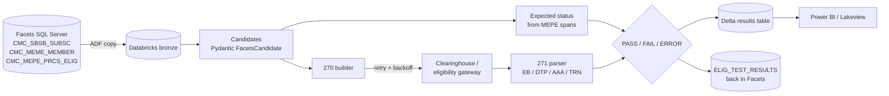

# Facets EDI Test Automation

[](https://github.com/kiranraou/facets-edi-test-automation/actions/workflows/tests.yml)

Two working test frameworks for a Facets (TriZetto) payer system:

1. **Eligibility 270/271**: pulls members from Facets, generates 270 inquiries, parses 271 responses, decides PASS/FAIL against Facets as the source of truth, and loads the results back.
2. **Claims 837P/837I**: builds scenario-driven claims, validates them with Pydantic business rules, writes compliant X12 837 files, loads them into Facets, and compares the claim tables field by field.

Everything runs on a laptop. A SQLite database stands in for Facets, and a mock gateway stands in for the clearinghouse. The same code runs on Databricks (Spark + Delta) and calls the real gateway over HTTP.

```bash
python3.12 -m venv .venv && source .venv/bin/activate
pip install -e ".[dev]"

pytest                                  # 154 tests, < 1 s, no Spark needed
run-eligibility --members 20000 --workers 25
run-claims --inject-defect P-MOD25-001=drop_last_modifier
```

---

## Project 1: Facets eligibility (270/271)

### Flow



### How expected eligibility is derived (Facets = source of truth)

For each member, `expected.py` reads the medical (`CSPD_CAT='M'`) spans in `CMC_MEPE_PRCS_ELIG` and compares them with the service date:

| Scenario | Facets data | Expected 271 |
|---|---|---|
| active | span with `ELIG_IND='Y'`, `EFF_DT <= svc <= TERM_DT` | `EB*1`, dates match `MEPE_EFF_DT`/`TERM_DT` |
| reinstated | old termed span + current span | `EB*1` |
| terminated | all Y spans end before svc | `EB*6` |
| future_effective | Y span starts after svc | `EB*6` |
| elig_ind_off | covering span has `ELIG_IND='N'` | `EB*6` |
| coverage_gap | svc falls between two spans | `EB*6` |
| member_not_found | ID not in Facets (synthetic probe) | `AAA*N**75*C` |
| invalid_member_id | malformed ID (synthetic probe) | `AAA*N**72*C` |

The PASS/FAIL decision (`decision.py`) also checks that `TRN02` echoes the trace number, that `NM109` echoes the member ID, that the AAA reason code matches, and that the coverage dates match Facets.

### Scaling to 20,000+ checks per run

`process_partition()` in `pipeline.py` is a pure-pandas function, so it can run in two places:

* **Locally**: round-robin chunks run on a 25-thread pool.
* **On Databricks** (`spark_job.py`): `df.repartition(25, "meme_ck").mapInPandas(per_partition, schema)`. Each task creates its own `HttpEligibilityGateway` and appends to the Delta table.

Gateway calls go through `call_with_retry`. Timeouts and HTTP 408/429/502/503/504 errors retry with exponential backoff (`base * 2^(n-1)`, capped, with ±10% jitter). When retries run out, the row is recorded as `ERROR`, not `FAIL`, so infrastructure noise stays separate from real defects on the dashboard.

### Sample local run

```
Run ELIG-...: 20050 eligibility checks on 25 workers in 2.9s (21079 gateway calls incl. retries)

scenario           PASS  FAIL  ERROR  total  pass_rate_%
active            13153     5      0  13158        99.96
...
PASS 20040  FAIL 10  ERROR 0  pass rate 99.95%
```

The 10 failures are defects injected on purpose with `--drift 10`: the mock gateway gives the wrong answer for 10 members, simulating a gateway that is out of sync with Facets. About 1,000 extra gateway calls come from the simulated 5% transient failure rate (`--failure-rate`).

---

## Project 2: Facets claims (837P/837I)

### Flow

```
scenario catalog -> SyntheticFactory (PHI-safe, deterministic, Luhn-valid NPIs)
   -> ClaimAdapter (Pydantic discriminated union: 837P | 837I)
        negative scenario: must be rejected by the expected rule; never reaches Facets
        positive scenario: write 837 -> replicate member/provider into Facets
                           -> intake into CMC_CLCL_CLAIM / CMC_CDML_CL_LINE / CMC_CLHP_HOSP
                           -> field-level compare (expected vs actual)
```

### Business rules (Pydantic validators in `claims/models.py`)

* Total charge (CLM02) equals the sum of the line charges. Lines are numbered 1..n with no gaps.
* Diagnosis codes must be valid ICD-10-CM format, 1 to 12 per claim. Each 837P diagnosis pointer must reference an existing code.
* Each line allows at most 4 modifiers. 837P lines require a procedure code (SV101). 837I lines require a revenue code (SV201).
* Service dates cannot be in the future or before the patient's date of birth.
* NPIs must pass the Luhn check digit. Tax IDs must have a valid EIN prefix. The place of service must be on the allowed list.
* 837I rules:
  * The bill type format is `0` plus three characters.
  * Inpatient bill types (`011x`, `018x`, `021x`, `041x`) require an admission date and admission type.
  * Admission must be on or before the statement-from date. Discharge must be on or after admission and equal the statement-through date.
  * Every line must fall within the statement period.

### Scenarios

| Positive | Negative (must be rejected before Facets) |
|---|---|
| office visit 99213 | invalid diagnosis code |
| 99214-**25** + 93000 same day | future date of service |
| telehealth **POS 10** + modifier 95 | total charge ≠ sum of lines |
| multi-unit 97110 × 4 | 5 modifiers on one line |
| inpatient **0111** with CL1 / DTP*435 | 13 diagnosis codes |
| outpatient ED **0131** | non-sequential line numbers |
| | 837I line without revenue code |
| | inpatient claim without admission date |

### What a Facets mismatch looks like

```
FAIL 837P positive office_visit_modifier_25  262930000200
     CMC_CDML_CL_LINE[262930000200/1].CDML_MOD1: expected '25', actual None
```

The generated 837 files are written to `out/837/`.

---

## Repository map

| Path | Purpose |
|---|---|
| `src/facets_qa/common/` | X12 envelope writer/tokenizer, D8/RD8 dates, NPI Luhn check, retry with backoff |
| `src/facets_qa/eligibility/models.py` | Contracts: `FacetsCandidate`, `Eligibility270Request`, `Eligibility271Response`, `AAARejection`, `BenefitLoop` |
| `src/facets_qa/eligibility/expected.py` | Expected status from `CMC_MEPE_PRCS_ELIG` |
| `src/facets_qa/eligibility/builder_270.py` / `parser_271.py` | 270 generation and 271 parsing |
| `src/facets_qa/eligibility/gateway.py` | HTTP gateway (real) and mock gateway (fault/drift injection) |
| `src/facets_qa/eligibility/decision.py` | PASS/FAIL/ERROR logic |
| `src/facets_qa/eligibility/pipeline.py` | Local runner and results loader; `spark_job.py` is the Databricks entry point |
| `src/facets_qa/claims/` | Claim models, scenarios, generator, 837 writer, Facets intake and validation |
| `src/facets_qa/sql/` | Mock Facets DDL (SQLite + Delta), candidate extract query, dashboard views |
| `src/facets_qa/lakehouse/` | Databricks jobs: create/seed Facets tables, publish claims runs to Delta |
| `app/` | Streamlit app (local or Databricks App) |
| `scripts/deploy_databricks.py` | SDK-based deploy: wheel, jobs, app (no new CLI needed) |
| `adf/` | Azure Data Factory pipeline: Facets SQL Server to Databricks bronze |
| `databricks.yml` | Asset Bundle equivalent (serverless; needs Databricks CLI >= 0.250) |
| `Jenkinsfile` | pytest with JUnit XML (unit, then integration), then bundle validate/deploy |

## Databricks Free Edition + Streamlit

Mock Facets lives in `workspace.facets_qa` (Unity Catalog, Delta). There's no real Facets: the setup job seeds
20,000 synthetic members, and the regression job runs both suites on serverless compute.

```bash
cp .env.example .env   # once: add DATABRICKS_HOST + DATABRICKS_TOKEN (.env is git-ignored)
python scripts/deploy_databricks.py --run setup             # DDL + seed 20k members
python scripts/deploy_databricks.py --run regression        # 270/271 on 25 Spark partitions + 837 suite
python scripts/deploy_databricks.py --app                   # deploy/refresh the Streamlit Databricks App
```

| Object | What it holds |
|---|---|
| `cmc_sbsb_subsc`, `cmc_meme_member`, `cmc_mepe_prcs_elig` | Seeded membership + eligibility spans |
| `cmc_prpr_prov`, `cmc_clcl_claim`, `cmc_cdml_cl_line`, `cmc_clhp_hosp` | Claims loaded by the 837 suite |
| `elig_test_results`, `claim_test_results` | Run history (append) |
| `vw_elig_run_summary`, `vw_elig_scenario_results`, `vw_elig_failure_trend` | Dashboard views (Power BI / Lakeview) |

How the jobs work on Databricks:
* **Eligibility:** `repartition(25).mapInPandas(process_partition)`. In `--gateway mock` mode, every task gets a
  Facets snapshot. Use `--gateway http --gateway-url ...` for a real clearinghouse.
* **Claims:** runs on the driver, then overwrites the claim tables and appends the results.

**Streamlit app:** run `streamlit run app/app.py` (the sidebar switches between local SQLite and the Databricks
warehouse). It has four tabs:
* Run dashboard: KPIs, checks by scenario, pass-rate trend, failures CSV.
* Facets explorer: member, spans, expected 271, table browser.
* 270/271 playground: build a real 270, see the 271, the parsed model and the PASS/FAIL decision.
* Claims lab: run any scenario, inject an intake defect, see the 837 and the CLCL/CDML/CLHP rows.

Free Edition limits: compute is serverless only, there's one 2X-Small warehouse, and an app stops after 24 hours
(restart it from **Compute → Apps**). The nightly schedule is created **paused**.

## Test suite

```bash
pytest -m contracts      # Pydantic data contracts (candidates, 270, 271)
pytest -m "builder or parser or x12"
pytest -m retry          # backoff math, retry exhaustion, non-transient errors
pytest -m decision       # expected-status derivation and PASS/FAIL rules
pytest -m claims         # 837P/837I business rules, every scenario
pytest -m facets         # replication + field-level Facets validation
pytest -m integration    # end to end against the in-memory mock Facets
```

None of the tests import Spark. Time-dependent rules use dates relative to today, and every random generator is seeded.

## Notes and limits

* The Facets tables are a **representative subset** of the real columns. The modifier columns in `CMC_CDML_CL_LINE` (`CDML_MOD1..4`) are simplified names. Map them to your Facets version's columns before pointing `facets_validation.py` at SQL Server.
* Eligibility covers subscribers only (`MEME_SFX = 0`, loop 2100C). Dependents would need loop 2000D/2100D.
* Against a real Facets environment, the 837s go to the inbound EDI folder and `facets_loader.FacetsClaimsIntake` is not used. Only `validate_claim()` runs, against SQL Server. The intake class exists so the framework runs on a laptop.
* All test data is synthetic. Member IDs `7xxxxxxxx` and `8xxxxxxxx` are reserved for QA, and names and addresses are obviously fake.
